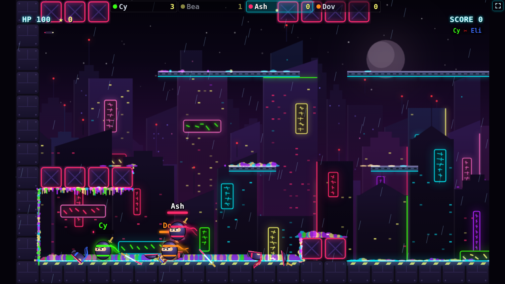
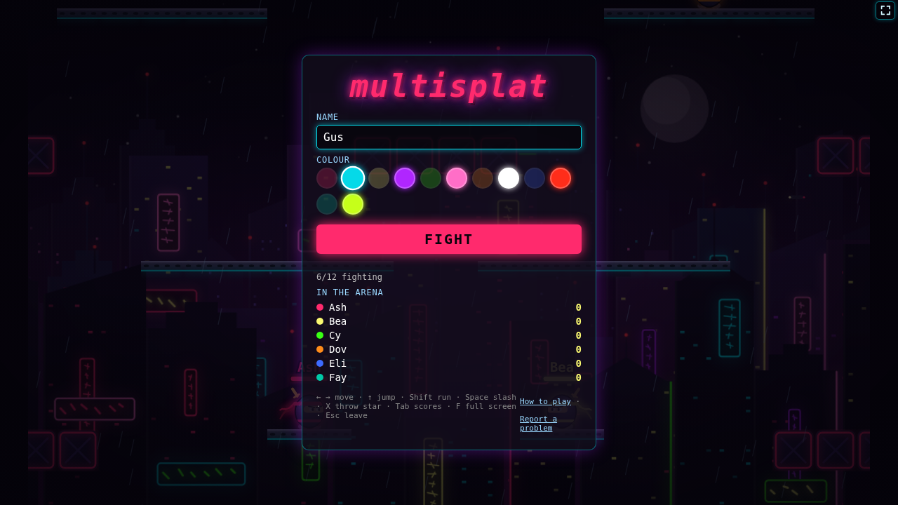
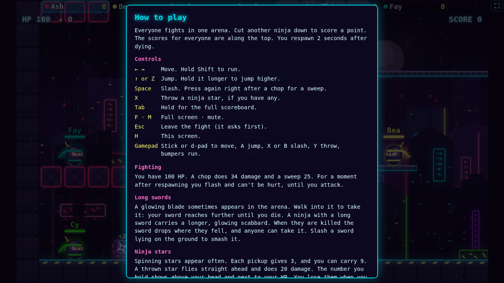
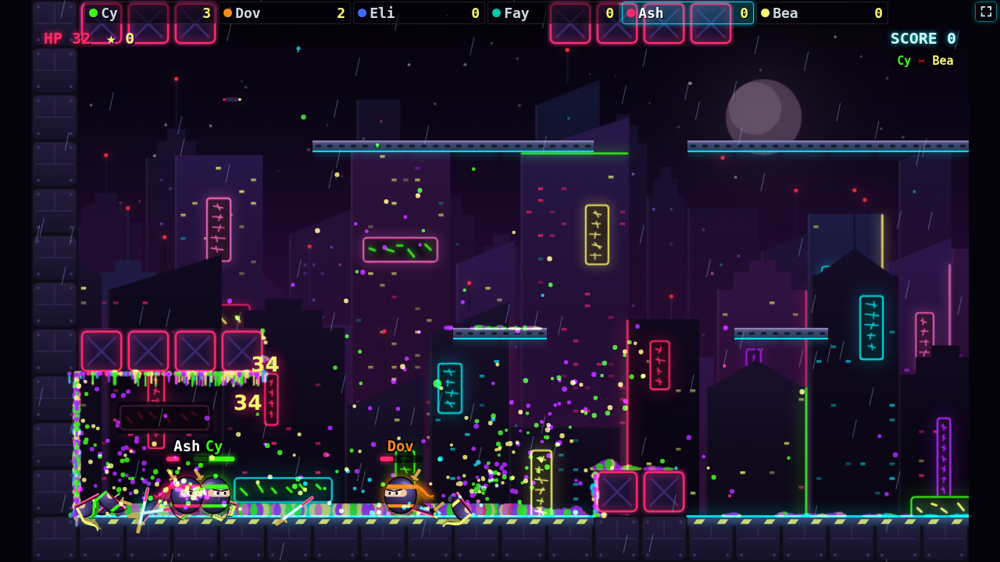
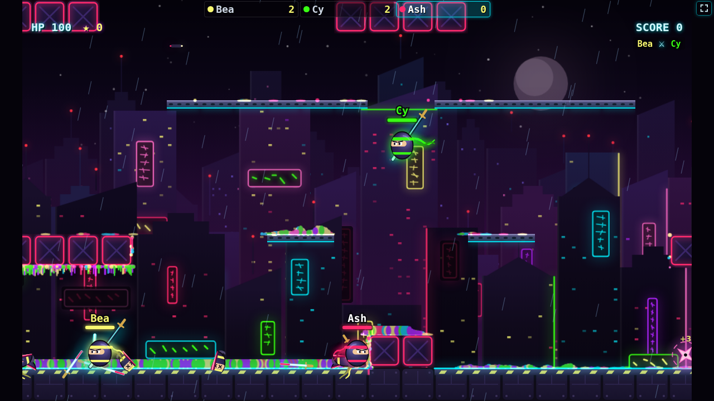

# multisplat

An online multiplayer ninja arena for the browser. Up to 12 players fight in one
neon-lit arena with swords and ninja stars. Cutting another ninja down scores
a point, and you respawn 2 seconds after dying. The server is
Node with [`ws`](https://www.npmjs.com/package/ws), the client is vanilla
Canvas, and there is no build step. The character is Kanbei.



## Features

- One arena for up to 12 fighters. Further players wait in a queue and are let
  in as slots free up.
- Drop-in play: pick a name and a colour in the lobby and press Fight.
- Sword combat with a chop and a follow-up sweep.
- Long swords: a pickup that lengthens your reach until you die. The sword
  drops where its holder fell, anyone can take it, and a slash smashes one
  lying on the ground.
- Ninja stars: pickups give 3 (carry up to 9), thrown stars fly straight ahead.
- Gore, with neon blood by default or a realistic blood option.
- Combat music and sound effects, synthesised in the browser.
- Keyboard, gamepad and touch controls.
- Server-authoritative netcode with client prediction, interpolation and lag
  compensation.
- Remote debug reports that players can send from the game.

| Lobby | How to play |
|---|---|
|  |  |

| A kill | Long sword and ninja star |
|---|---|
|  |  |

## Controls

| Keyboard | Action |
|---|---|
| Left / Right | Move. Hold Shift to run. |
| Up or Z | Jump. Hold it longer to jump higher. |
| Space | Slash. Press again right after a chop for a sweep. |
| X | Throw a ninja star, if you have any. |
| Tab | Hold for the full scoreboard. |
| F / M | Full screen / mute. |
| Esc | Leave the fight (it asks first). |
| H | Show the How to play screen. |

| Gamepad | Action |
|---|---|
| Stick or d-pad | Move |
| A | Jump |
| X or B | Slash |
| Y | Throw a ninja star |
| Bumpers | Run |

| Touch | Action |
|---|---|
| Left / right arrows | Move. Tap the double arrow to switch running on or off. |
| Up arrow | Jump. Hold it longer to jump higher. |
| Crossed swords | Slash. Tap again right after a chop for a sweep. |
| Star | Throw a ninja star, if you have any. |

A chop does 34 damage, a sweep 25 and a thrown star 20. You have 100 HP.

## Quick start

Requires Node 20 or newer.

```bash
npm ci
npm start
```

Then open <http://localhost:3008>. The server listens on `127.0.0.1` by
default; open the page in several tabs to fight yourself.

## Hosting it

To run it for other people, put it behind a reverse proxy. [DEPLOY.md](DEPLOY.md)
covers nginx and systemd templates (in `deploy/`), running behind a second
proxy, a smoke test of a deployed server, and debugging player problems.

## Configuration

Everything site-specific comes from environment variables (`HOST`, `PORT`,
`ALLOWED_ORIGINS`, `TRUST_PROXY`, `MAX_PER_IP`, `MAX_CONN`, `DEBUG_DIR`,
`DEBUG_PORT`, ...). The full table is in section 10 of [SPEC.md](SPEC.md) and
in [DEPLOY.md](DEPLOY.md).

## Tests

| Command | What it runs | Needs |
|---|---|---|
| `npm test` | Unit tests (`node --test test/*.test.js`) and the repository hygiene check | Node only |
| `npm run test:abuse` | Server limits (oversize messages, bad origin, floods, connection caps) against a real server process | Node only |
| `npm run test:multi` | Headless multi-client test: three browsers fight, score, respawn, reconnect, send a debug report, and pick up long swords and stars | Chromium, via `PLAYWRIGHT_CHROMIUM` or playwright's cache (`npx playwright install chromium`) |

`npm run test:all` runs the three in turn. Each test starts its own server on a
spare port.

## Project layout

```
shared/    constants, the arena, and the deterministic 60 Hz simulation (used by server and client)
server/    HTTP and WebSocket server, authoritative arena, debug report intake
public/    the client: game.js, net.js, gore.js, music.js, debug.js, index.html
tools/     debug.js, a command-line client for the debug admin listener
deploy/    systemd and nginx templates
test/      unit tests, browser and abuse tests, scripted bots
```

## Documentation

- [SPEC.md](SPEC.md): what the game is and how it should behave.
- [ARCHITECTURE.md](ARCHITECTURE.md): how it is built.
- [DEPLOY.md](DEPLOY.md): how to run and host it.
